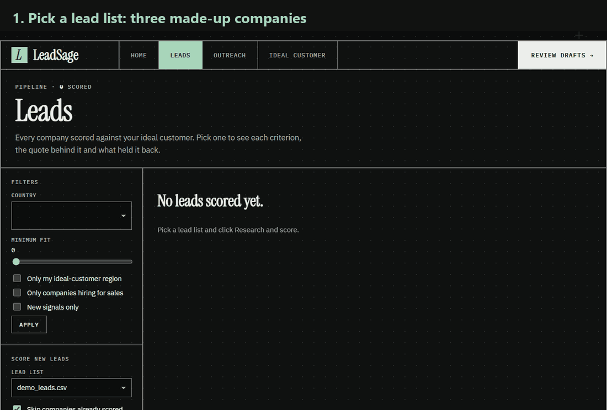
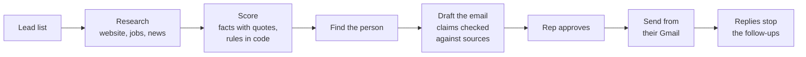
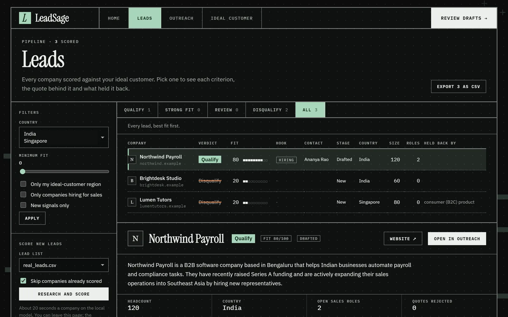
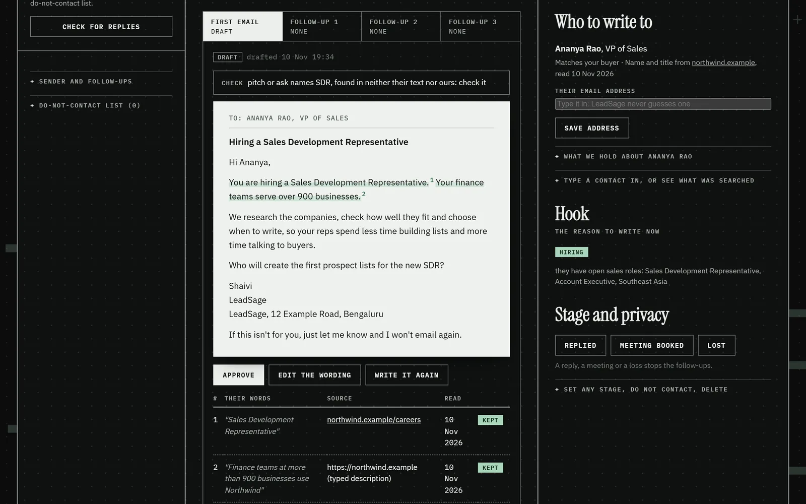
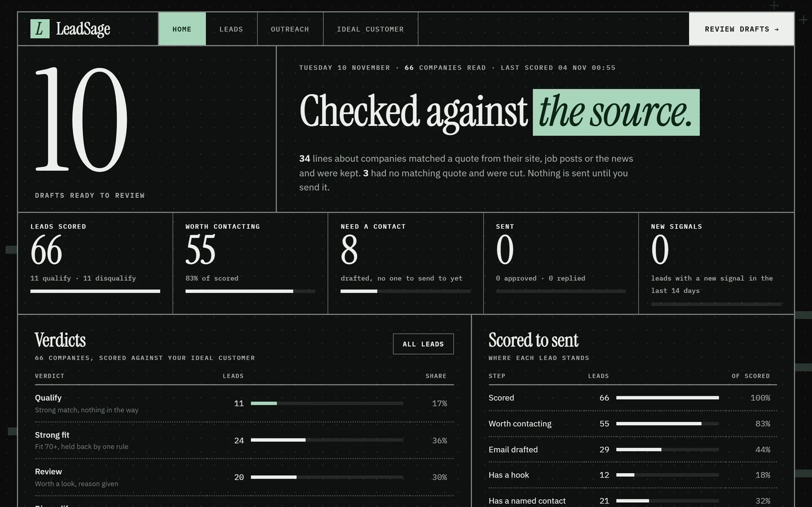

# LeadSage

**Prospect research and first emails for teams that sell to businesses. Every line about a company has a source.**

[](https://github.com/Sp-dev5/LeadSage/actions/workflows/ci.yml)



*The real app, recorded start to finish on three made-up companies (`data/demo_leads.csv`): scoring, the reasons, the contact, a drafted email with its sources, approval and the audit trail. Models ran live. There is no hosted demo: the models run on your own machine, and the [quick start](#quick-start) replays this in a few minutes.*

Salespeople spend most of their day reading up on companies, finding the right person and writing "personal" emails one at a time. LeadSage does that work: describe your ideal customer, give it companies, and it researches each one, scores it with reasons, finds who to write to and drafts the emails. A person approves every email before it goes out.

## At a glance

- **Finds and researches companies** from the open Y Combinator list, their own websites, job boards and Indian startup news.
- **Scores each one against your ideal customer** and says why, with a quote behind every reason.
- **Drafts a first email and three follow-ups.** A line about the prospect that has no matching quote is cut before you see it.
- **A person approves every email**, then it sends from their own Gmail. Replies stop the follow-ups, and "not interested" puts the company on a do-not-contact list.
- **Shows its work:** every model prompt and answer for a lead is kept and shown on the lead's page.
- **Runs on your laptop** with local models. No paid APIs.

**Built with** Python, FastAPI, SQLite, Ollama (local LLMs), `nomic-embed-text` embeddings for retrieval, SMTP and IMAP. CI runs 797 tests, `bandit`, `pip-audit` and a secrets scan on every pull request.

## How it works



The model reads and writes; code decides. It answers fixed questions about a company with a quote for each answer, code checks every quote word for word, and the verdict comes from rules in `data/icp.json` that the model never sees. Full picture, data model and failure handling: **[architecture](docs/architecture.md)**.

## See it work

Screenshots of the real app on made-up companies (`.example` domains). **[Worked example](docs/examples/northwind-payroll.md)**: one lead from website text to an approved email, with the scoring output, the email's sources and the full audit trail.

**Scoring, with the reason behind each number.** Northwind Payroll qualifies; a tutoring app and a design agency are disqualified, each with its reason.



**An email where every claim has a source.** Each sentence about the prospect is tied to the words it came from, and the rep still approves it.



**The dashboard**, from a run on 66 real companies (counts only).



## Results

**Against a person's labels.** 57 companies labelled by hand before scoring (47 made up, 10 real scored from their websites). Full method and per-set numbers: **[evaluation](docs/evaluation.md)**.

| Question | Precision | Recall | False positives | False negatives |
|---|---|---|---|---|
| Worth a rep's time? (qualify or review, against disqualify) | 87% | 100% | 5 of 23 | 0 of 34 |
| Qualify? | 59% | 76% | 9 | 4 |

It never dropped a lead the person wanted, and it is generous at the top: of the 22 it qualified, 8 were labelled review and 1 disqualify. On the 37 companies never used for tuning, 65% match exactly.

**A run on 66 real companies** (from the Y Combinator list and Indian startups, read mostly from their own websites): 55 worth contacting (11 qualify, 24 strong fits held back by one rule, 20 to review), 11 disqualified, 29 emails drafted. Of the lines about prospects in those drafts, 34 matched a quote and were kept, 3 had none and were cut.

**Sending and replies**, tested end to end on real Gmail: an approved email sent, a "not interested" reply in the same thread found over IMAP, the company moved to do-not-contact and its follow-ups stopped. The reply came from the same account, not a separate person.

**Failure cases** are tested: a send clicked twice delivers one email; an email the server took before the app could note it is never sent again without the rep checking; a refused send can be retried; eight threads writing at once lose nothing; a model that times out hands over to the other model; one failing lead never stops a batch. See [architecture: failure handling](docs/architecture.md#failure-handling).

**What this does not show.** No real sales campaign was run, so there are no reply rates, revenue or measures of how often reps edit drafts. One person labelled the benchmark. A quote check proves the words exist, not that a sentence reads them right; the [worked example](docs/examples/northwind-payroll.md#4-the-email-every-claim-tied-to-a-source) shows one it missed, and the email writer made the same misreading in three of the four drafts it wrote for that company.

## Quick start

Needs Python 3.12 and [Ollama](https://ollama.com).

```bash
pip install -r requirements.txt
ollama pull qwen3.5:9b && ollama pull qwen3.5:4b && ollama pull nomic-embed-text
cp .env.example .env                                  # optional: Groq key, Gmail, app password
uvicorn web.app:app --host 127.0.0.1 --port 8000      # open http://127.0.0.1:8000
```

To replay the demo: on the Leads page pick `demo_leads.csv` and click Research and score. For real companies:

```bash
python -m agent.find --industry B2B --limit 20        # real companies into data/found_leads.csv
python -m agent.pipeline --file found_leads.csv       # research and score them
python -m agent.outreach --draft                      # find contacts and draft first emails
python -m agent.benchmark                             # precision and recall against the labels
```

Tests: `pip install -r requirements-dev.txt` then `pytest` (no model or network needed). The ideal customer lives in `data/icp.json`; edit it on the Ideal customer page. All commands: [docs/features.md](docs/features.md#commands).

## Layout

| Folder | What's in it |
|---|---|
| `agent/` | The pipeline: finding companies, research, scoring, contacts, emails, sending, the audit trail, your documents, the benchmark |
| `web/` | The FastAPI app: routes, templates, CSS |
| `data/` | The ideal customer and outreach settings, labelled sets and their results, the demo list, sample documents (the lead store itself is git-ignored) |
| `tests/` | pytest suite, with fake models and mailboxes |
| `site/` | A one-page website for the product |
| `deploy/` | Guide and scripts for a free Ubuntu server behind HTTPS |
| `docs/` | Architecture, evaluation, worked example, features |

## Docs

| Doc | What's in it |
|---|---|
| [docs/architecture.md](docs/architecture.md) | How it is built: diagram, each step, where the model is trusted, data, models, failure handling, security |
| [docs/evaluation.md](docs/evaluation.md) | The benchmark: method, confusion matrix, precision and recall, limits |
| [docs/examples/northwind-payroll.md](docs/examples/northwind-payroll.md) | One lead start to finish: scoring output, cited email, audit trail |
| [docs/features.md](docs/features.md) | Every part in detail, and every command |
| [docs/differentiators.md](docs/differentiators.md) | Signal-triggered timing, and the trust layer under it |
