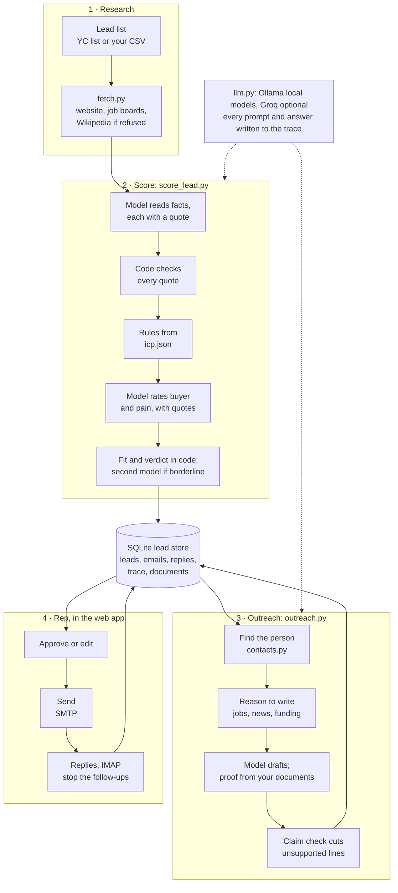

# Architecture

How LeadSage is built today. One Python codebase: command-line modules in `agent/` and a FastAPI app in `web/`, sharing one SQLite file. Models run locally in Ollama; a free Groq model can write the emails; mail goes through the rep's own mailbox.

## The steps

| Step | Module | What happens |
|---|---|---|
| Find companies | `agent/find.py` | Pulls active companies from the open Y Combinator list into a CSV, filtered by the ICP's size and countries. Or bring your own CSV. |
| Research | `agent/pipeline.py`, `fetch.py`, `signals.py`, `wikipedia.py` | Reads each homepage (robots.txt checked at every redirect), open sales jobs from Ashby, Greenhouse, Lever and others, or a Wikipedia summary when the site refuses. A failed fetch never stops a batch. |
| Score | `agent/score_lead.py` | Two model calls and the rest in code. See below. |
| Find the person | `agent/contacts.py` | Reads the company's own team and about pages; the model lists the people named; code picks the one matching the buyer persona. Never guesses an email address. |
| Find a reason to write | `agent/hooks.py`, `press.py`, `watch.py` | Open sales roles, dated news on the company's own site, or a funding headline from Inc42, YourStory or Entrackr. |
| Draft | `agent/outreach.py`, `kb.py` | The model writes structured fields (subject, claims with quotes, pitch, ask, optional proof line from your documents). Code assembles the email and cuts any claim whose quote is not in the source. |
| Approve and send | `web/app.py`, `agent/mailer.py` | The rep approves, edits or redrafts. Send goes over SMTP from the rep's mailbox, one at a time, capped per day. |
| Replies | `agent/mailer.py` | IMAP, read-only, searching only for answers to our own Message-IDs or from contacted people. A reply stops the follow-ups; an opt-out or delete request is acted on. |
| Watch | `agent/watch.py` | Rereads job boards, news and feeds on a schedule you set and flags what is new. |
| Export | `agent/export.py` | CSV in HubSpot's import columns. No live CRM sync. |

## Where the model is trusted, and where it isn't

The model is used for reading and writing language. Decisions sit in code and config, where they can be tested and changed without touching a prompt.

- **Facts, not scores.** The scoring model answers fixed questions ("does it build its own software?", "who are its customers?") and must quote the text for each answer. Code checks every quote word for word; a fact with a missing quote becomes "unknown". If a quote fails, the model is asked once more, naming only the failed facts.
- **Rules in config.** Industry scores, size limits, regions, the rules that send a lead to review or disqualify, the weights and cut-offs all live in `data/icp.json`. The model never sees the weights.
- **Judgement with evidence.** Buyer fit and pain are the only model ratings, each with a quote that is checked the same way.
- **Second opinion.** A borderline lead is scored again by a second model; disagreement sends it to review.
- **Every claim in an email has a source.** The model returns each claim with the quote it rests on. A claim whose quote is not in the company's text, job posts or news is cut before the rep sees the draft. Names and numbers in the pitch that appear nowhere in the sources are flagged.
- **A person sends.** Nothing leaves without approval.

## Data

One SQLite file, `data/leadsage.db` (git-ignored), opened per call with `secure_delete` on, so deleted rows are overwritten.

| Table | Holds |
|---|---|
| `leads` | Company, research text, score with every reason, stage |
| `contacts` | The people found and the one chosen, with where each came from |
| `emails` | Each step of the sequence: draft, approved, sent or stopped, with citations and the Message-ID |
| `replies` | First 500 characters of each reply, opt-out and delete flags |
| `suppressed` | The do-not-contact list |
| `news`, `signal_events`, `watched`, `site_checks` | What the watcher saw and when |
| `trace` | Every step of every run per lead, with full prompts and answers (last 3 runs of each kind) |
| `kb_files`, `kb_passages` | Your documents, split into passages with their embeddings |
| `logins` | Web sessions, so logging out really ends one |

Config is plain JSON in `data/`: `icp.json` (who to sell to, every rule and weight) and `outreach.json` (sender, follow-up days, daily cap, thresholds).

## Models

| Use | Model | Where |
|---|---|---|
| Facts, ratings, people on team pages | `qwen3.5:9b` | Ollama, local |
| Second opinion, and the stand-in when a model crashes or times out | `qwen3.5:4b` | Ollama, local |
| Email drafts | `gpt-oss-120b` on Groq's free tier if a key is set, else `qwen3.5:9b` | Groq or local |
| Document search | `nomic-embed-text` | Ollama, local |

All model calls go through `agent/llm.py`, which also writes each prompt and answer to the trace. Swapping a model touches only that file.

## Failure handling

Each case below has a test in `tests/test_failures.py` or nearby.

| Failure | What happens |
|---|---|
| A model crashes, times out or returns broken JSON | Asked once more on the other local model; the lead says which model scored it and stays at review. Both failing is an error for that lead only. |
| Ollama is not running | Each call fails at once with "is `ollama serve` running?"; no other model is tried. |
| Groq fails | The local model writes the draft, and the draft says so. |
| One lead fails in a batch (fetch, model, or saving it) | Reported, and the batch moves on. |
| Send clicked twice | One email goes out: sends are taken one at a time, and the second finds it already sent. |
| The app stops after the mail server took an email but before it was marked sent | The Message-ID is written before the server is contacted, so the email is not sent again; the rep is asked to check their Sent folder and mark it sent. |
| The mail server refuses (bad password, unknown address, spam block) | Nothing went out; the email stays approved and can be sent again. |
| Several writes at once (a background job and page clicks) | SQLite serialises them; tested with 8 threads writing 160 leads. |
| A file save is interrupted | Written to a temporary file and swapped in, so a crash never leaves half a file. |

## Security and personal data

- **Fetching**: robots.txt honoured at every redirect, private and internal addresses refused (with the connection pinned to the checked address), 10 MB cap, no JavaScript run.
- **Prompt injection**: page text is passed as data and the prompts say so; `agent/injection_check.py` plants instructions in company text and checks they don't steer the models; document passages that address an AI are dropped at indexing; proof lines that read like an offer are cut.
- **Web app**: optional shared password with lockout after five tries, signed sessions that logout really ends, a token on every form, no internal errors shown.
- **Secrets** live in `.env` (git-ignored); CI scans every pull request for secrets, runs `bandit` and audits pinned dependencies.
- **Personal data**: the source of every name is kept, a "What we hold" view per person, delete requests from replies acted on, and people never emailed forgotten after 180 days.

## Not built

The original plan also had a live HubSpot sync, open and click tracking, an engagement-driven score and a pipeline Kanban. They are not built: a sync needs a CRM account, tracking pixels need hosting, and an engagement score needs real outcome data to check against. Leads move to a CRM by import file instead.
